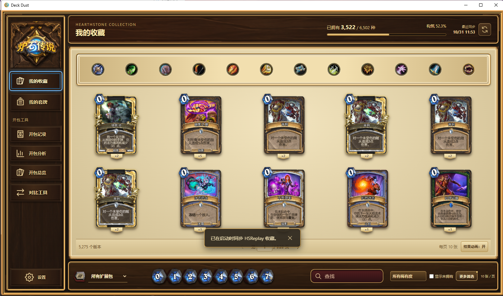
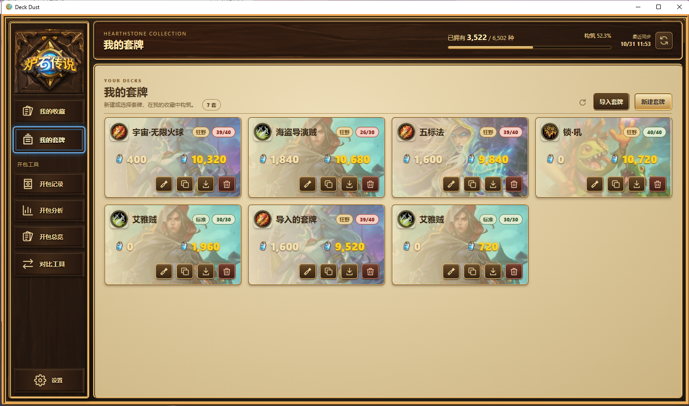
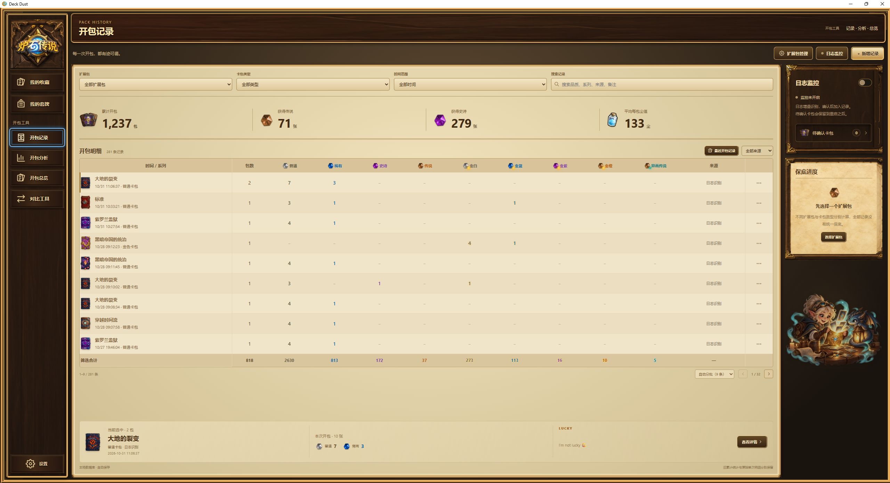
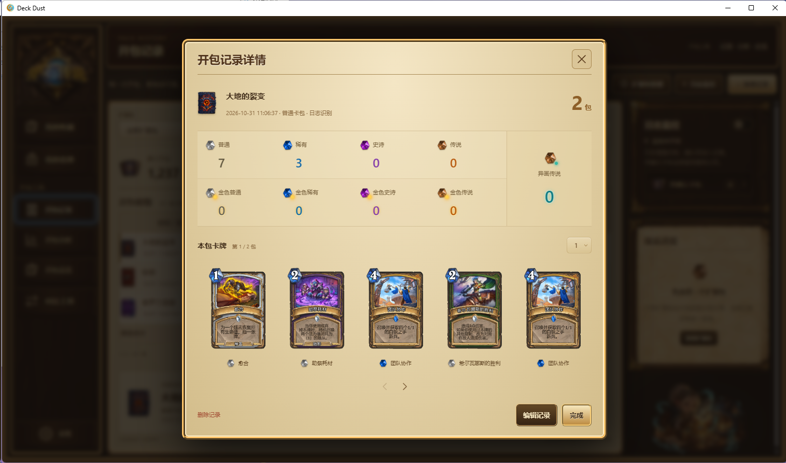

**本项目完全由 AI 开发。** 从需求梳理、架构设计、前端与桌面端编码，到功能实现和项目文档，均由 AI 完成。Deck Dust 是一个完整的 AI 开发软件项目。

# Deck Dust

Deck Dust 是一款面向 Windows 的《炉石传说》本地收藏、套牌构筑和开包记录工具。应用使用 React、Vite、Python 和 SQLite，将收藏与记录保存在本机，并提供可选的 HSReplay 同步和 Neon 备份。

[](LICENSE)

## 界面预览

### 收藏管理



### 套牌列表



### 开包记录



### 开包详情



## 功能介绍

### 收藏管理

- 按职业、扩展包、法力值、稀有度、卡牌类型、品质和持有数量筛选卡牌，并支持搜索、排序与分页。
- 支持普通、金色、钻石和异画/签名品质；缺卡判断可合并品质统计，也可只查看指定品质。
- 展示个人收藏进度、扩展包收集进度和普通卡合成粉尘估算。
- 支持 HDT / HSReplay JSON 文件校验、预览、导入、导出、备份和恢复。无效或空数据不会覆盖已有收藏。
- 卡牌目录随项目提供；卡面按需加载并缓存到本机，网络图片不可用时仍可使用本地收藏资料。

### 套牌构筑与比较

- 在收藏页面中选择卡牌构筑套牌，按职业、费用等条件筛选，并查看当前收藏中可用的品质和缺卡数量。
- 支持套牌新建、继续编辑、复制、删除、卡组代码导入和导出，以及 JSON 文件导入和导出。
- 保存卡牌品质数量；卡组代码不保存品质，JSON 会保留品质信息。
- 提供套牌差异比较，可比较已保存套牌或解析粘贴的卡组代码，并查看牌张和粉尘差异。

### 开包记录与分析

- 手动记录开包数量和卡牌品质，支持记录编辑、删除、筛选和详情查看。
- 支持扩展包与卡包类型管理，展示品质统计、历史区间、保底进度、平均每包价值和开包总览。
- 可选监控 Hearthstone 日志。识别到的开包会进入待确认流程，确认后才写入记录；日志识别不会自动改动收藏。
- 支持按扩展包、卡包类型、日期和关键词查看记录，并展示实际卡牌明细（来源数据可用时）。

### 本地数据与可选同步

- 收藏、套牌和开包记录分别保存在 `%LOCALAPPDATA%\Deck Dust\Data` 下的 SQLite 文件中。
- 可通过 HSReplay 官方登录窗口同步收藏；登录会话由当前 Windows 用户的 DPAPI 加密保护。
- 可选将本机 SQLite 一致性快照备份至用户自行配置的 Neon 数据库。Neon 连接串由 DPAPI 加密后保存在本机。
- 应用的基本本地功能不要求配置 HSReplay 或 Neon。卡牌图片加载需要网络连接。

## 运行与开发

目前仓库提供源码，尚未发布预构建 EXE。

### 环境要求

- Windows 10 或更新版本。
- Node.js 20 或更新版本。
- Python 3.12。
- Microsoft Edge WebView2 Runtime（桌面窗口需要）。

### 从源码运行桌面应用

```powershell
npm install
npm run build
python -m pip install -r desktop-requirements.txt
python desktop_app.py
```

首次启动后，应用会自动启动本机页面服务并打开桌面窗口。若 WebView2 Runtime 不可用，请先安装或修复 WebView2 Runtime。

### 开发模式

在两个 PowerShell 窗口中分别运行：

```powershell
npm run dev:server
```

```powershell
npm run dev
```

随后打开 Vite 输出的本地开发地址。

### 构建网页

```powershell
npm run build
```

构建输出位于 `web-dist/`。桌面端的 PyInstaller 文件夹版配置见 `DeckDust.spec`；打包前需要先构建网页，并按 [开发说明](DEVELOPMENT.md) 检查要求。

## 隐私与安全

请勿提交用户数据库原件、收藏导出、HSReplay 会话、Neon 连接配置、日志或本机绝对路径。公开截图应避免显示账号标识、联系方式、登录凭据及其他不希望公开的信息。测试和手动验证应使用临时数据目录，可通过 `DECK_DUST_DATA_DIR` 指定。

应用不会把用户数据库打包进源码构建。HSReplay 和 Neon 均为可选连接；请勿在 Issue、Pull Request、截图或日志中分享凭据。

## 权利与使用声明

- Deck Dust 与 Blizzard Entertainment、《炉石传说》、HSReplay 和 HearthstoneJSON 均无隶属或背书关系。第三方商标、卡牌资料、图像和其他内容归各自权利人所有；MIT 许可证不授予这些第三方内容的额外权利。
- 如果你认为本项目中的代码、图片、文字、截图或其他内容侵犯了你的著作权或其他合法权益，请通过 [GitHub Issues](https://github.com/NingAres/DeckDust/issues) 联系作者，并提供相关内容位置及权利说明。作者会核实，并在确认后及时删除或调整相关内容。
- 禁止将本项目或其中任何内容用于违法活动。使用者须遵守所在地适用法律、第三方服务条款及相关权利人的要求。


## 文档

- [贡献指南](CONTRIBUTING.md)
- [开发说明](DEVELOPMENT.md)
- [项目功能与数据规则](PROJECT_REQUIREMENTS.md)
- [变更记录](CHANGELOG.md)
- [云端备份约定](CLOUD_BACKUP.md)
- [云端备份操作](CLOUD_OPERATIONS.md)
- [第三方素材与许可说明](THIRD_PARTY_NOTICES.md)

## 许可与致谢

Deck Dust 的源码和原创文档依照 [MIT License](LICENSE) 发布。第三方图像、卡牌资料、商标和游戏内容不属于 MIT 许可范围，相关权利归各自权利人所有；请查看 [第三方说明](THIRD_PARTY_NOTICES.md)。

Deck Dust 与 Blizzard Entertainment、《炉石传说》、HSReplay 和 HearthstoneJSON 均无隶属或背书关系。
